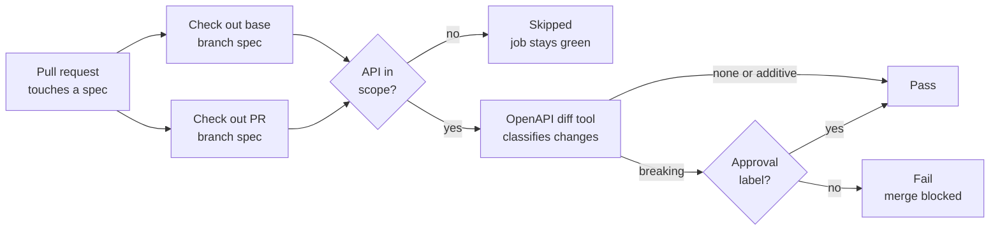

# Breaking Change Detection for API Specs

How a breaking change gate works, and how to audit whether it still protects your APIs.

## Overview

A breaking change gate compares each proposed API spec with the spec already released. It stops the merge when a change would break existing clients. It only protects the APIs it actually checks. A green result says nothing about APIs the gate skipped.

A breaking change is any spec edit that can make a working client fail. Common examples:

- Removing an endpoint or an HTTP method
- Renaming or moving a path
- Removing a response field, or changing its type
- Adding a required request field or parameter
- Narrowing an enum, or tightening a constraint on input
- Adding a required security scope to an existing operation

Additive changes are usually safe. Examples are a new endpoint, a new optional field, or a new response field.

## How It Works

The gate runs as a CI job on every pull request that touches a spec file.

1. **Trigger.** The job runs when a PR changes a spec or a shared component file. It also reruns when labels change.
2. **Two snapshots.** The job checks out the base branch spec and the PR branch spec side by side. A git worktree is a cheap way to do this.
3. **Scope filter.** The job decides which APIs to compare. See [Scope](#scope).
4. **Diff and classify.** An OpenAPI diff tool compares the two specs for each API in scope. It sorts each change into breaking, non-breaking, or none.
5. **Gate.** Any breaking change fails the job, unless the PR carries an approval label.

The same detector also runs locally before a push. Developers then see the result before CI does.

## Implementation

The gate is a thin layer of scripts around an open source diff tool. Each piece has one job.

| Piece | Tool | Job |
| --- | --- | --- |
| Diff engine | [oasdiff](https://github.com/oasdiff/oasdiff) | Compares two OpenAPI specs and classifies each change |
| Detector script | Node.js | Finds changed specs, applies scope, runs oasdiff per API, prints a summary, sets the exit code |
| CI wrapper script | Node.js + GitHub CLI (`gh`) | Passes in the PR number and label state, builds a PR comment, posts it |
| CI job | GitHub Actions | Runs the wrapper on PRs that touch spec files |
| Scope registry | JSON file | Lists the APIs opted into versioning, with opt-in date and supported versions |
| Local hook | git pre-push hook | Lints specs, then runs the detector in check-all mode |
| Installer | Bootstrap script | Downloads the oasdiff release binary for the OS and CPU; falls back to Homebrew or `go install` |

### Diff engine

oasdiff does the real work. The detector calls it twice per API:

- `oasdiff breaking <base> <head> --format=json --fail-on ERR` lists breaking changes. oasdiff grades each change as `ERR` (breaking) or `WARN` (possibly breaking). `--fail-on ERR` makes it exit non-zero when any `ERR` appears.
- `oasdiff diff <base> <head> --format=json` lists every change, including non-breaking ones. This feeds the summary of additive changes.

oasdiff resolves `$ref` links, so changes in shared components show up under each API that uses them.

### Detector script

1. **Pick the base.** The default is the main branch. It can also be the last release tag or any commit.
2. **Find changed specs.** `git diff --name-only <base>...HEAD` lists the files the PR changed.
3. **Apply scope.** Read the registry and drop APIs that are not opted in, unless check-all is on.
4. **Get the base spec.** Create a git worktree of the base ref. This gives oasdiff a full copy of the old spec, so its relative `$ref` paths still resolve.
5. **Run oasdiff** for each API in scope and collect the results.
6. **Report and exit.** Print checked, skipped, breaking, and non-breaking counts. Exit non-zero if an opted-in API has a breaking change.

### CI wrapper and job

- The job triggers on PR open, push, reopen, and label changes. It only runs when a spec or shared component file changed.
- It checks out full git history. The detector needs the base branch to diff against.
- It passes a flag when the approval label is present. The wrapper then turns a failing result into a pass.
- The wrapper can post a PR comment through `gh api`. It has a dry-run mode and a no-comment mode.

### Local hook

The pre-push hook runs the same detector with check-all on. It is informational only. It prints a red banner for breaks on opted-in APIs and a yellow banner for other APIs, but it never blocks the push.

## Scope

Scope decides which APIs the gate compares. It is the most important setting, and the easiest one to get wrong.

| Mode | What gets checked | Breaking change result | Good for |
| --- | --- | --- | --- |
| Opt-in only | APIs listed in a versioning registry | Fails the PR | Teams rolling out versioning one API at a time |
| Check all | Every API with spec changes | Fails for opted-in APIs; warns for the rest | Full visibility without blocking everyone |
| Enforce all | Every API with spec changes | Fails the PR | Mature repos where every API is a public contract |

Opt-in is a sensible way to start. The risk is that the registry stays small while the repo grows. The gate keeps passing, but it checks fewer and fewer of the APIs that matter.

## Approving an Intentional Breaking Change

Some breaking changes are intended, for example removing a deprecated endpoint. The gate needs an escape hatch for these.

- A reviewer adds an approval label to the PR, such as `breaking-change-approved`.
- The label change reruns the job. The job sees the label and passes.
- The label leaves an audit trail. Anyone can find every approved break by searching PRs for that label.

Keep the label restricted to people who own the API contract. A label anyone can add turns the gate into a speed bump.

## How We Audited the Gate

The question was simple: does the gate still catch breaking changes? A wall of green runs does not answer it. We used these steps.

1. **List recent runs.** Pull the last 10 to 20 runs of the gate job from CI. Note pass or fail, duration, and PR title.
2. **Find known breaking PRs.** Look for PRs that obviously break clients. Titles with `!` in a conventional commit, "remove", or "rename" are good leads. Each of these should have failed, or carried the approval label.
3. **Read the logs, not the status.** Open the gate step's output for a few runs. Look for what was checked, what was skipped, and what the diff tool reported.
4. **Check for timing outliers.** A run much faster than usual can mean real work was skipped. It can also be a harmless cache hit. The log tells you which.
5. **Trace the scope source.** Find where the gate gets its list of APIs to check. Compare that list with the APIs that recent PRs changed.
6. **Replay a known break.** Run the gate locally against a past merge that you know is breaking. Use the commit before the merge as the base. Turn on check-all mode. If the tool flags the break, the detector works and only the scope is off.

## What the Audit Showed

The gate was healthy, but its coverage was not. Every run passed, and every run checked only one API out of more than 40.

- PRs that removed an endpoint or renamed a path passed. Their APIs were never in scope.
- The scope registry had not changed since the gate was introduced. Nothing broke recently. The gap had been there from the start.
- A check-all mode already existed in the script, but CI never turned it on.
- The local pre-push hook did use check-all. Its warnings are non-blocking, so they were easy to miss.
- PR comments were turned off, so authors never saw what was skipped.
- The short run times came from a dependency cache hit, not from skipped work.

The lesson is general. A gate that skips most of its input will almost always pass. A pass with low coverage looks exactly like a pass with full coverage.

## Options to Close the Gap

| Option | Effect | Tradeoff |
| --- | --- | --- |
| Turn on check-all in CI | Every changed API is diffed; non-opted-in breaks show as warnings | Warnings are easy to ignore unless they reach the PR |
| Opt more APIs into the registry | Breaks on those APIs fail the PR | Teams must adopt the approval label workflow |
| Enforce all APIs | Every break fails until approved | Most friction; best fit once all APIs are public contracts |
| Turn on PR comments | Authors see checked, skipped, and flagged APIs | Small change; makes every other option visible |

These options stack. A low-friction start is check-all plus PR comments. Opt in each API once its owners are ready to have breaks block the merge.

Any of these will start flagging PRs that pass today. Agree on the rollout with API owners before switching it on.

## Health Checklist

Use this list for any breaking change gate, on a regular schedule or after big repo changes.

- [ ] The job runs on every PR that touches a spec or a shared component
- [ ] The log names which APIs were checked and which were skipped
- [ ] The checked list covers the APIs that clients actually depend on
- [ ] A known breaking change, replayed locally, is flagged by the diff tool
- [ ] Recent PRs with obvious breaks either failed or carry the approval label
- [ ] Only API contract owners can add the approval label
- [ ] Results reach the PR author, as a comment or a summary
- [ ] Run time outliers have an explanation in the logs
